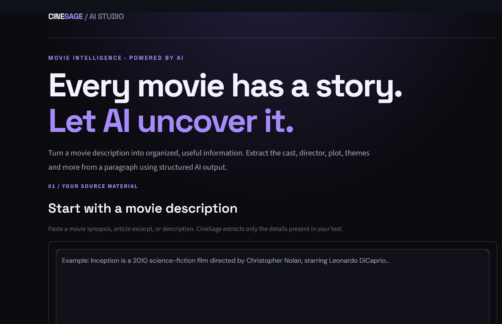

# 🎬 CineSage — AI-Powered Movie Intelligence

Turn movie descriptions into structured information with Generative AI.

CineSage is a GenAI application that extracts useful movie details from user-provided text using **LangChain, Groq, and Pydantic**. It transforms unstructured paragraphs into organized information through an interactive Streamlit interface.

<p align="center">

  **[🚀 Try the Live Demo](https://genai-projects-3hmgd8gx28e4nhzuhnp6xp.streamlit.app/)**


  

</p>

## ✨ Features

- **Structured Information Extraction** — Extract movie details from descriptive text.
- **Movie Metadata** — Identify the title, director, release year, genre, and IMDb rating when provided.
- **Cast & Story Analysis** — Organize cast members, plot, setting, themes, and music composer.
- **Schema-Based Output** — Use Pydantic to structure model responses.
- **Interactive Web Interface** — Explore extracted information in a polished, dark-themed Streamlit UI.
- **JSON Export** — Download structured movie results as a JSON file.
- **Two Extraction Approaches** — Compare prompt-based generation with schema-based extraction.

## 🖥️ Live Application

**[Open CineSage](https://genai-projects-3hmgd8gx28e4nhzuhnp6xp.streamlit.app/)**

Paste a movie description, run the extraction, explore the organized results, and download the structured output.

## 🧠 How It Works

1. **Input:** The user provides a paragraph containing movie information.
2. **Prompt Engineering:** LangChain constructs a prompt with extraction instructions.
3. **LLM Processing:** A Groq-hosted language model processes the text.
4. **Structured Parsing:** Pydantic and `PydanticOutputParser` organize the response according to the defined schema.
5. **Presentation:** Streamlit displays the extracted information in readable sections and provides a JSON download.

## 🛠️ Tech Stack

| Technology | Purpose |
|---|---|
| Python | Core programming language |
| LangChain | Prompt construction and LLM integration |
| Groq | Hosted language model inference |
| Pydantic | Structured data validation |
| Streamlit | Interactive web interface |
| python-dotenv | Local environment variable management |

## 📂 Project Structure

```text
CineSage/
├── core.py
├── structured.py
├── UIcore.py
├── UIstructured.py
├── requirements.txt
└── README.md
```

- `core.py` — Prompt-based movie information extraction.
- `structured.py` — Schema-based extraction using Pydantic.
- `UIcore.py` — Streamlit interface for the core extraction approach.
- `UIstructured.py` — Enhanced Streamlit interface with structured results and JSON export.
- `requirements.txt` — Dependencies required by the CineSage Streamlit application.

## ⚙️ Setup

### 1. Clone the repository

```bash
git clone https://github.com/bansod-dev/GenAI-Projects.git
cd GenAI-Projects
```

### 2. Install dependencies

For CineSage, install its dedicated requirements:

```bash
pip install -r CineSage/requirements.txt
```

### 3. Configure the Groq API key

Create a `.env` file in the repository root and add:

```text
GROQ_API_KEY=your_groq_api_key
```

Obtain an API key through the [Groq Console](https://console.groq.com/).

**Security:** Never commit your `.env` file, API keys, or other credentials to GitHub. The deployed application uses Streamlit Cloud Secrets for its API key configuration.

## ▶️ Run the Applications

Run these commands from the repository root.

**Core extraction — terminal**

```bash
python CineSage/core.py
```

**Structured extraction — terminal**

```bash
python CineSage/structured.py
```

**Core extraction — Streamlit**

```bash
streamlit run CineSage/UIcore.py
```

**Structured extraction — Streamlit**

```bash
streamlit run CineSage/UIstructured.py
```

## ⚠️ Limitations

- Extraction quality depends on the supplied text and the language model's response.
- Missing information may be returned as "Not mentioned" or a null value, depending on the field.
- Generated results may contain inaccuracies; verify important information independently.
- The configured Groq model must be available to your account.
- Structured extraction depends on the model response being compatible with the defined Pydantic schema.

## 👨‍💻 Author

**Ghanshyam Bansod**

AI & Data Science Student | Aspiring Data Scientist

- **GitHub:** [bansod-dev](https://github.com/bansod-dev)
- **Project Repository:** [GenAI-Projects](https://github.com/bansod-dev/GenAI-Projects)
- **Live Demo:** [CineSage](https://genai-projects-3hmgd8gx28e4nhzuhnp6xp.streamlit.app/)

---

*Built to explore prompt engineering, structured LLM outputs, and practical Generative AI application development.*
